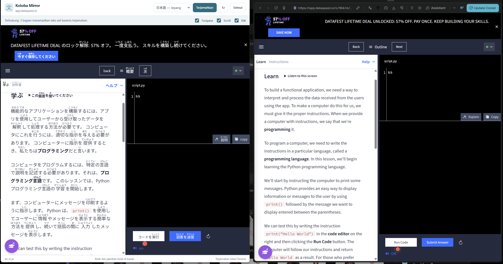
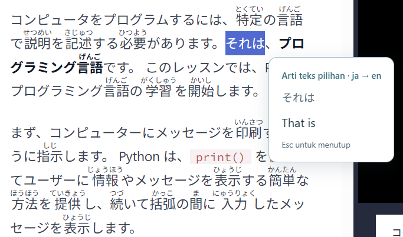

# Kotoba Mirror

Learn from a website in two languages at once. Kotoba Mirror keeps the translated page on the left and the original, working website on the right, with connected scrolling and clicks.

English → Japanese is the default. Other language pairs supported by Chrome can be selected. Translation runs locally through Chrome's Translator API; no API key or translation server is required.

## How it works

### Read a lesson side by side

The original website keeps its login, editor, and lesson state. The left window shows a translated copy, with optional Japanese furigana. Clicking the mirror forwards one action to the original page.



### Select a phrase to see its meaning

Highlight text in the translated window and hover over the selection to translate just that phrase back into the original language. Furigana readings are excluded from the selected text.



These screenshots were supplied by the project owner and illustrate the workflow on Dataquest. They may show an earlier version. Version **0.3.3** adds scrollable popovers for long text.

## Features

- Two Chrome windows arranged left and right automatically.
- Synchronized document and nested-panel scrolling.
- Click forwarding through a single live website session.
- Local translation with a memory cache and complete-sentence context.
- Optional hiragana furigana using a bundled local dictionary.
- Hover a paragraph to read its full original text, or highlight a phrase for a specific translation.
- Scroll inside long popovers; move the pointer into the popover to keep it open. Close with **×** or **Esc**.
- Stable translated views: updates are prepared out of sight and shown only when ready.
- Original window position and size restored when the session ends.

## Install

Use **Google Chrome desktop 138+** with the Translator API available.

1. Download and extract the release ZIP, or download/clone this repository.
2. Open `chrome://extensions`.
3. Enable **Developer mode**.
4. Click **Load unpacked** and choose the folder containing `manifest.json`.
5. Pin **Kotoba Mirror** using Chrome's extensions menu.

No build step, Node.js, or account is required to use the extension. Node.js is only needed for development checks.

## Use

1. Open your lesson in Chrome and log in normally.
2. Click the Kotoba Mirror icon and choose the source and learning languages.
3. Click **Buka kiri–kanan** to arrange the windows.
4. In the left window, click **Aktifkan terjemahan**. Chrome may download a language pack on first use.
5. Read and navigate from either side. Type answers, run code, and use media in the original window on the right.
6. Toggle **Furigana**, **Scroll**, or **Klik** as needed.
7. Click **Selesai**, or close the mirror, to restore the original window.

For long hover text, move into the popover and scroll. Its header and close button remain available while the full text scrolls. Selected-text translation supports up to 2,000 characters.

To update an existing installation, replace the extension files, click **Reload** on `chrome://extensions`, and start a new session. The current version is **0.3.3**.

[Panduan lengkap dalam Bahasa Indonesia](docs/guide.id.md)

## Privacy and permissions

The extension requests `activeTab`, `scripting`, and `storage`. It has no blanket website host permission. It accesses the page you explicitly activate it on.

Lesson snapshots and translation caches stay in memory during the session. Language and synchronization preferences are stored locally. There is no analytics service or external translation backend. Normal site images, fonts, and stylesheets can still make network requests, and Chrome needs internet access for initial language-pack downloads.

## Compatibility

- Desktop Chrome only; another Chromium browser may not expose the same translation API.
- Code blocks remain unchanged. Inputs are mirrored read-only; type in the original page.
- Embedded frames, Shadow DOM, canvas, video, and text in images are not translated.
- Some controls require trusted pointer events and must be used on the original website.
- Same-origin navigation reconnects automatically. After navigating to another domain, activate the extension on the new page.
- Machine translations and automatic furigana can be wrong, especially for names or ambiguous words.
- Automated checks use controlled lesson pages. The Dataquest screenshots show the owner's usage, not a guarantee of compatibility with every lesson or website.

## Development

The extension uses Manifest V3 and plain JavaScript. Runtime dependencies are bundled under `vendor/`; it does not load remote JavaScript.

| File | Purpose |
| --- | --- |
| `background.js` | Session lifecycle, window arrangement, and message routing |
| `source.js` | Sanitized snapshots, element mapping, and original-page actions |
| `mirror.js` | Translation, hidden preparation, and stable view updates |
| `translation-blocks.js` | Sentence grouping, inline formatting, and safe fallback rendering |
| `selection-translation.js` | Original-text and selection popovers |
| `furigana.js`, `furigana-worker.js` | Local reading annotation |
| `demo.html` | Local learning-page fixture |

See [TESTING.md](TESTING.md) for validation coverage. If Python is installed, serve the demo from this folder with `python -m http.server 8765 --bind 127.0.0.1`, then open `http://127.0.0.1:8765/demo.html` and activate the extension.

For a full repository checkout, run the automated UI and stability checks with Node.js 20+:

```sh
npm ci
npx playwright install chromium
npm test
```

Tests use isolated browser profiles under the ignored `work/` directory. They prefer installed Google Chrome when available; set `KOTOBA_CHROME_EXECUTABLE` to choose another executable. A test-only copy of the manifest receives localhost access; the release manifest keeps its original permissions.

To build an installable ZIP with Python, run `python scripts/package.py`. The runtime ZIP is written to `dist/` and excludes development dependencies and browser profiles.

## Third-party software

Furigana uses [Kuromoji.js](https://github.com/takuyaa/kuromoji.js) and its bundled IPADIC dictionary. Their licenses and notices are included in `vendor/kuromoji/`.

Translation API documentation: [Chrome Translator API](https://developer.chrome.com/docs/ai/translator-api).
